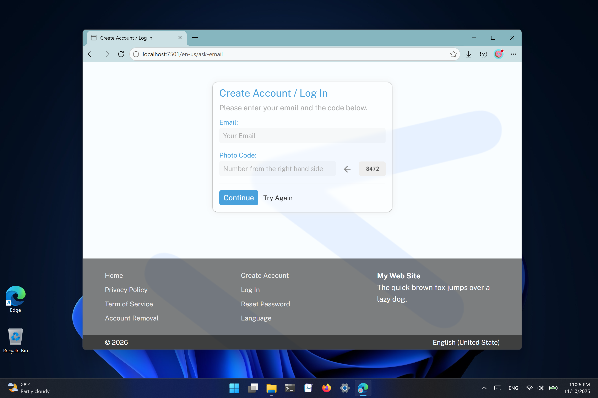
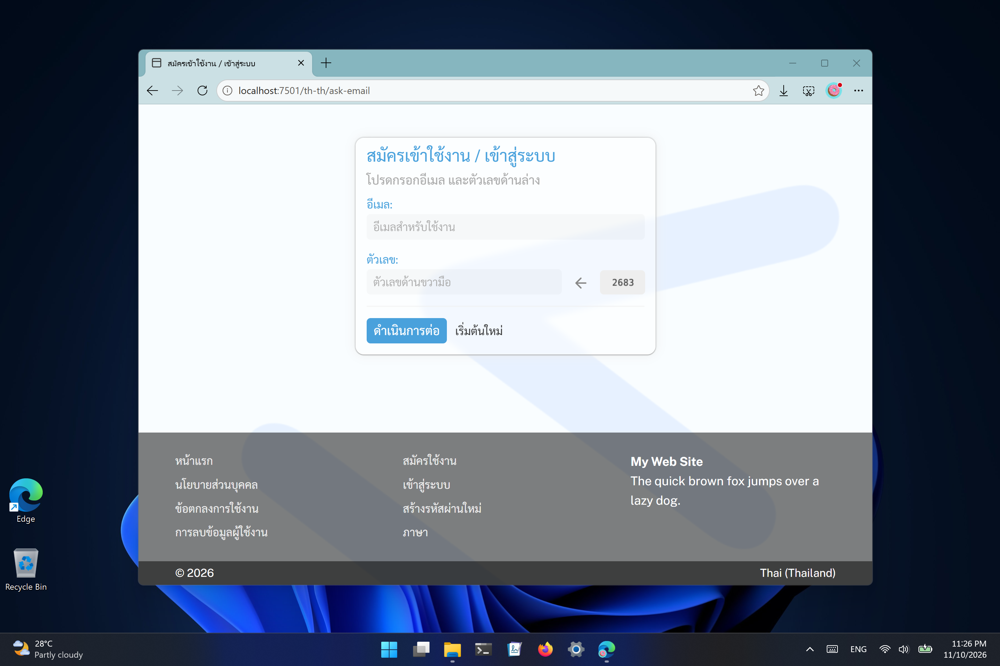

## starbase

A multiple languages web application.

Building project:
```
git clone https://github.com/kookiatsuetrong/starbase
cd starbase
mysql < schema.sql
mysql < translate.sql

bash make.sh or make.bat
```

Then open web browser to http://localhost:7501



This project supports multiple languages.

