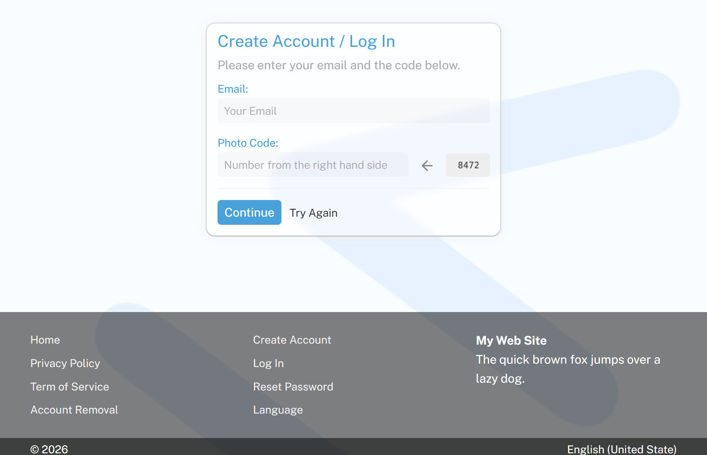
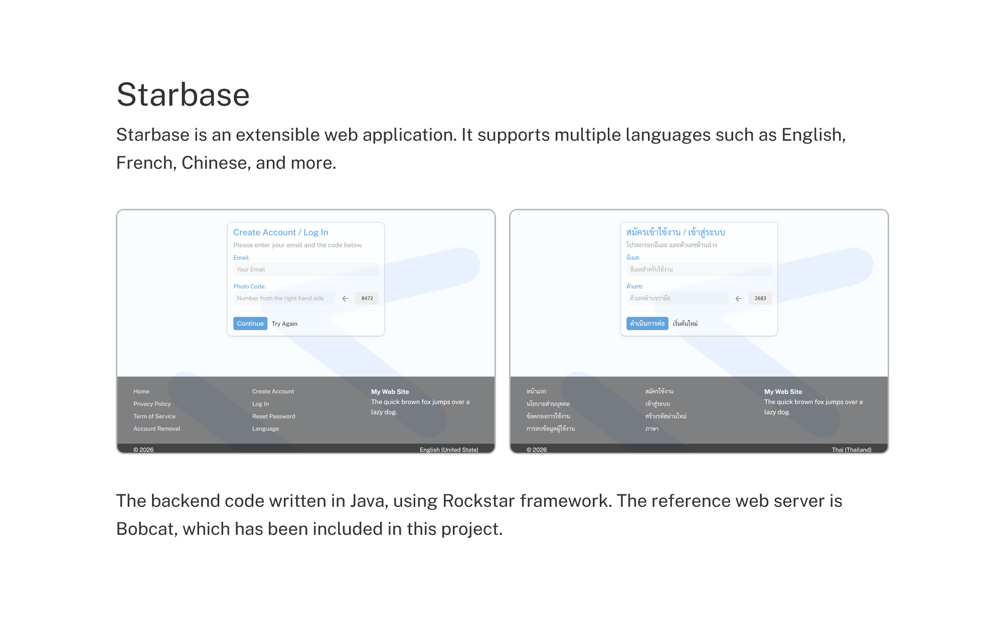

## starbase

A multiple languages web application.

Building project:
```
git clone https://github.com/kookiatsuetrong/starbase
cd starbase
mysql < schema.sql
mysql < translate.sql

bash make.sh or make.bat
```

Then open web browser to http://localhost:7501



This project supports multiple languages.



The dictionary is in the table "translations", as follow:
```
.---------.------------.----------------.----------------------.
| number  | code       | language       | text                 |
'---------'------------'----------------'----------------------'
  1         home         en-us            Home
  2         home         th-th            หน้าแรก
  3         language     en-us            Language
  4         language     th-th            ภาษา
  .
  .
```
